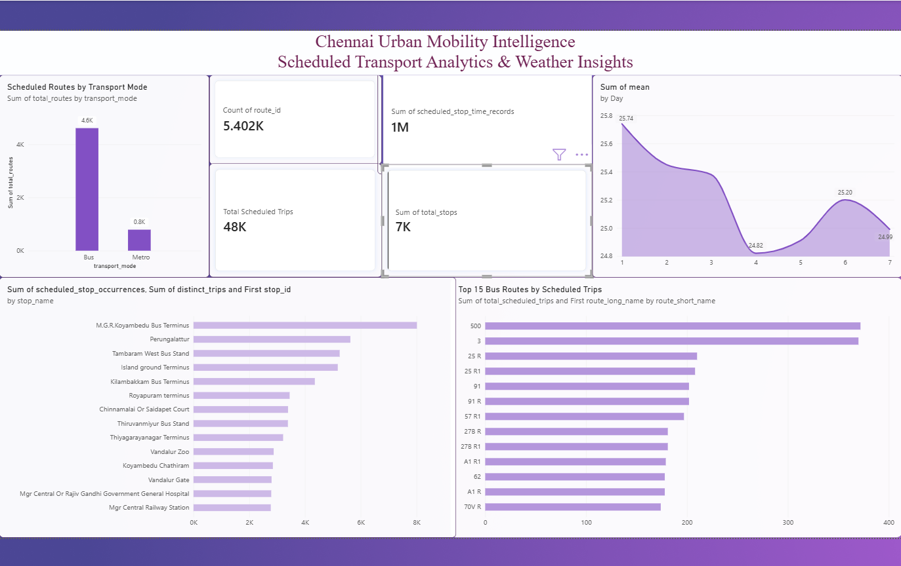

# Chennai Urban Mobility Intelligence Platform

An end-to-end data engineering and business intelligence project combining Chennai public transport schedule data and historical weather data to explore transport network patterns and weather trends.

## Project Overview

This project demonstrates a complete data workflow, from data ingestion and validation to PostgreSQL warehousing, SQL analytics, and Power BI dashboard development.

## Technologies Used

- **Programming:** Python, Pandas
- **Database:** PostgreSQL
- **Query Language:** SQL
- **Visualization:** Microsoft Power BI
- **Data Sources:** Open-Meteo Historical Weather API, Chennai GTFS dataset
- **Tools:** VS Code, Jupyter Notebook, Git, GitHub

## Architecture

1. **Data Ingestion:** Retrieve historical weather data and process GTFS public transport files.
2. **Data Validation:** Check required fields, duplicate identifiers, missing values, and relationships between transport entities.
3. **Data Warehousing:** Load transport data into PostgreSQL staging tables and structured warehouse tables.
4. **SQL Analytics:** Analyze transport modes, scheduled trips, route frequency, and stop activity.
5. **Data Export:** Export analytical results into CSV files using Python.
6. **Dashboard:** Visualize transport and weather indicators in Power BI.

## Dataset Summary

The processed transport dataset contains:

| Metric | Records |
|---|---:|
| Routes | 5,402 |
| Stops | 6,542 |
| Trips | 48,435 |
| Scheduled stop-time records | 1,389,081 |

The transport dataset includes bus and metro services. Historical weather analysis covers seven days, from January 1–7, 2025.

## Key Analyses

- Comparison of bus and metro route and trip counts.
- Identification of routes with the highest scheduled trip counts.
- Identification of stops with the highest scheduled stop occurrences.
- Daily minimum, maximum, and average temperature analysis.
- Data quality and relational integrity checks.

## Project Structure

```text
chennai_mobility_intelligence/
├── data/
│   └── processed/
│       └── analytics/
├── notebooks/
│   └── 01_weather_data_exploration.ipynb
├── sql/
│   └── analytics/
├── src/
│   ├── database/
│   ├── ingestion/
│   └── validation/
├── chennai_mobility_dashboard.pbix
├── requirements.txt
└── README.md
```

## How to Run

### 1. Clone the repository

```bash
git clone https://github.com/nvarshini975-byte/chennai-mobility-intelligence.git
cd chennai-mobility-intelligence
```

### 2. Create and activate a Python virtual environment

On Windows PowerShell:

```powershell
python -m venv venv
.\venv\Scripts\Activate.ps1
```

### 3. Install dependencies

```bash
pip install -r requirements.txt
```

### 4. Configure PostgreSQL

Install PostgreSQL and create a database named `chennai_mobility`. Configure the local database connection settings required by the scripts before running the ingestion and loading steps.

### 5. Explore the analysis

Open `notebooks/01_weather_data_exploration.ipynb` in Jupyter Notebook or VS Code to explore the weather dataset.

The raw GTFS files are not included in this repository. Obtain the source dataset and place its extracted files in `data/raw/gtfs/` before rerunning the transport ingestion and database workflow.

## Dashboard

Open `chennai_mobility_dashboard.pbix` with Microsoft Power BI Desktop to explore the report.



## Data Sources

- **Weather:** [Open-Meteo Historical Weather API](https://open-meteo.com/en/docs/historical-weather-api)
- **Transport:** [Chennai GTFS dataset on GitHub](https://github.com/ungalsoththu/ChennaiGTFS)

## Important Data Limitations

- GTFS data describes scheduled transport services, not actual vehicle locations or observed traffic congestion.
- The weather analysis covers only January 1–7, 2025.
- The transport dataset is a community-maintained source and should not be interpreted as a verified real-time official transport feed.

## Skills Demonstrated

Python data processing, SQL analytics, PostgreSQL data warehousing, data validation, ETL workflow development, CSV automation, Power BI dashboarding, and Git-based version control.

## Author

Developed as a portfolio project to demonstrate practical data engineering, analytics, and business intelligence skills.
